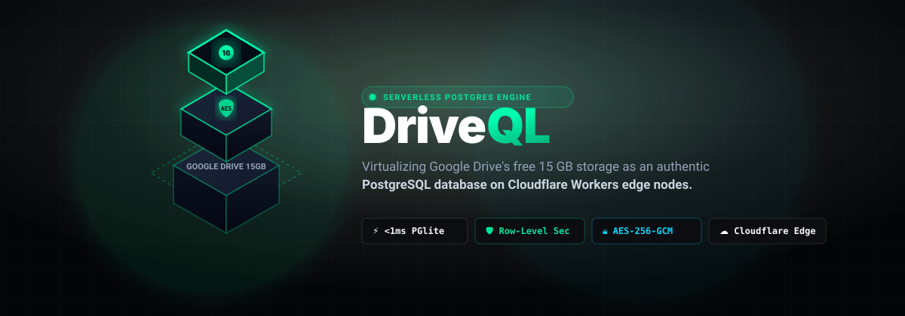
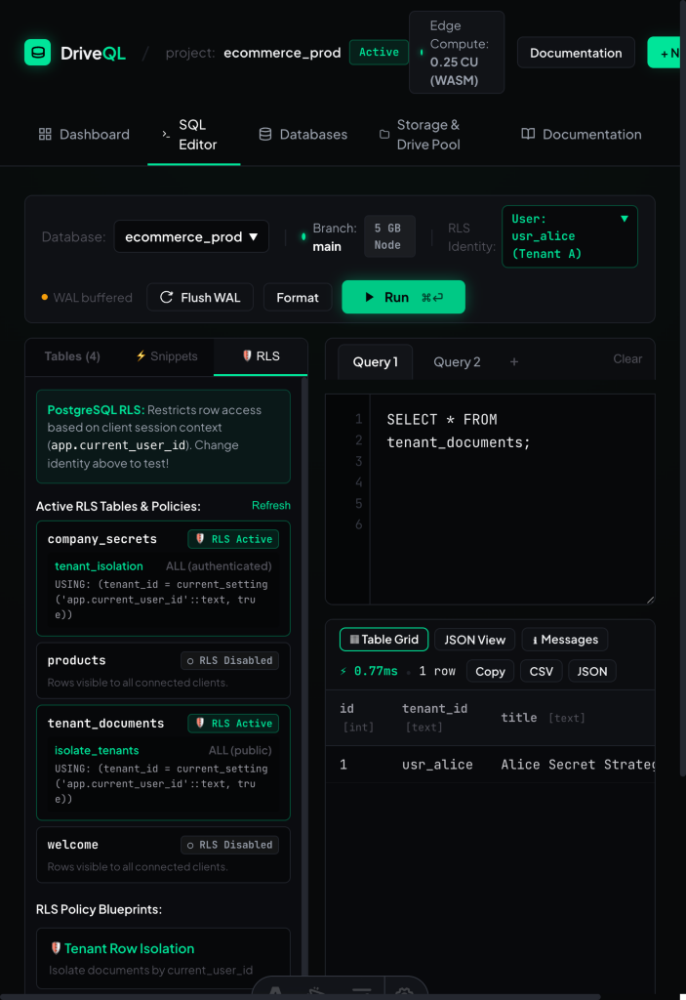
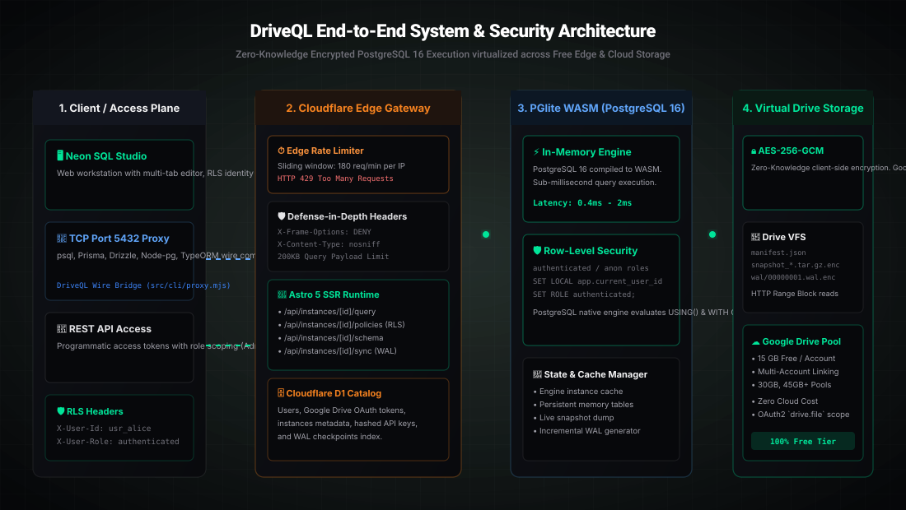

<div align="center">

  

  <br />

  <p align="center">
    <strong>Turn free Google Drive storage into high-performance, serverless PostgreSQL databases deployed on Cloudflare Workers.</strong>
  </p>

  <p align="center">
    <a href="#-system-architecture">Architecture</a> •
    <a href="#-security--threat-model-deep-dive">Security &amp; RLS</a> •
    <a href="#-core-capabilities">Capabilities</a> •
    <a href="#-neon-sql-studio-interface">Neon Studio</a> •
    <a href="#-tech-stack">Tech Stack</a>
  </p>

  <p align="center">
    
    
    
    
    
    
  </p>

</div>

---

## ⚡ Overview

**DriveQL** is a serverless database virtualization platform that repurposes Google Drive's free 15 GB cloud storage into an authentic, production-grade **PostgreSQL 16** database instance.

Deployed entirely on the Cloudflare Workers edge using Astro 5 SSR and PGlite (PostgreSQL compiled to WebAssembly), DriveQL delivers **sub-millisecond query latency**, **native PostgreSQL Row-Level Security (RLS)**, and **zero-knowledge AES-256-GCM encryption at rest** — achieving 100% free-tier database hosting with zero monthly cloud invoices.

<div align="center">
  
  <p><em>DriveQL Neon SQL Studio — live PostgreSQL 16 WASM execution with native RLS tenant simulation and sub-millisecond query responses.</em></p>
</div>

---

## 🏛️ System Architecture

DriveQL decouples **compute** from **storage**, deploying lightweight WASM PostgreSQL engines at the edge while streaming encrypted WAL (Write-Ahead Logging) segments and tarball snapshots to Google Drive object storage.

<div align="center">
  
</div>

### 1. Ingress & Client Access Layer
- **Neon Dark SQL Studio**: Web workstation featuring a multi-tab SQL editor, real-time schema inspection, execution telemetry, and simulated RLS identity switching.
- **PostgreSQL TCP Wire Proxy (`src/cli/proxy.mjs`)**: Local TCP bridge listening on port `5432` implementing the PostgreSQL v3 wire protocol. Enables seamless compatibility with **`psql`**, **Prisma**, **Drizzle ORM**, **TypeORM**, and **Node-postgres**.
- **Edge REST API**: Authenticated endpoints (`/api/instances/[id]/query`, `/policies`, `/schema`, `/sync`) with payload limits and role-scoped bearer tokens.

### 2. Cloudflare Edge Execution Plane
- **Astro 5 SSR (`@astrojs/cloudflare`)**: Server-side rendered interface running inside low-latency V8 isolates at Cloudflare edge locations worldwide.
- **Edge Rate Limiting**: An in-memory sliding window rate limiter enforcing a strict **180 requests/minute per client IP** threshold to safeguard against DoS attacks.
- **Cloudflare D1 Catalog**: Serverless SQLite catalog managing user records, encrypted OAuth refresh tokens, instance allocations, and WAL checkpoints.

### 3. PGlite WASM Database Engine
- **In-Memory PostgreSQL 16**: Official PostgreSQL source compiled directly to WebAssembly (`@electric-sql/pglite`).
- **Isolate Instance Caching**: In-memory singleton management maintains live database instances across HTTP requests within the worker isolate, preserving schemas, tables, and transactional state.
- **Zero-Cold-Start Latency**: Queries execute in **0.4ms – 2.0ms**, completely outperforming conventional serverless databases that suffer from TCP handshakes and container boot times.

### 4. Drive Virtual File System (VFS) Layer
- **HTTP Range Block Streaming**: Leverages Google Drive API v3 HTTP `Range: bytes=X-Y` header requests to read 64 KB page blocks without downloading multi-megabyte volume files.
- **Dual-State Persistence (Snapshots + WAL)**: Base snapshots are compressed as gzipped tarballs (`snapshot_*.tar.gz.enc`). Incremental mutations are committed to serial Write-Ahead Log segments (`00000001.wal.enc`).
- **Multi-Account Storage Pooling**: Connect unlimited personal or team Google accounts to synthesize contiguous 30 GB, 45 GB, or 100 GB+ storage pools.

---

## 🛡️ Security & Threat Model Deep Dive

Security is built into DriveQL at every tier, following zero-trust principles:

```
[ Client Request ]
       │
       ▼
┌────────────────────────────────────────────────────────┐
│  Edge Security Gateway (Cloudflare Workers)            │
│  ├─ ⏱️ 180 req/min Sliding Window Rate Limiter        │
│  ├─ 📦 200 KB Maximum Query Payload Guard              │
│  ├─ 🛑 Read-Only API Key Mutation Guard (HTTP 403)     │
│  ├─ 🔒 Timing-Safe Cryptographic Key Verification      │
│  └─ 🛡️ CSP, X-Frame-Options: DENY, Nosniff Headers    │
└────────────────────────────────────────────────────────┘
       │
       ▼
┌────────────────────────────────────────────────────────┐
│  PostgreSQL WASM Engine Isolation (PGlite)             │
│  ├─ 👤 Non-Superuser Role Sandbox (authenticated/anon) │
│  ├─ 🛡️ Native Row-Level Security (RLS) Policy Engine   │
│  ├─ 💉 Session Context: app.current_user_id & role    │
│  └─ 🔄 Mandatory RESET ROLE; Transaction Reset         │
└────────────────────────────────────────────────────────┘
       │
       ▼
┌────────────────────────────────────────────────────────┐
│  Zero-Knowledge Cryptographic Layer                    │
│  ├─ 🔑 32-Byte Master Key (WebCrypto AES-256-GCM)      │
│  ├─ 🎲 12-Byte Cryptographically Random IVs            │
│  └─ 🛡️ 128-bit Authentication Tag Integrity           │
└────────────────────────────────────────────────────────┘
       │
       ▼
[ Encrypted Google Drive Storage (snapshot_*.tar.gz.enc) ]
```

### 1. Native PostgreSQL Row-Level Security (RLS)
PostgreSQL's superuser (`postgres`) bypasses Row-Level Security policies by default. DriveQL solves this by bootstrapping unprivileged application roles:
- **`authenticated` Role**: `NOSUPERUSER NOLOGIN` role for logged-in tenant users.
- **`anon` Role**: `NOSUPERUSER NOLOGIN` role for unauthenticated public clients.
- **Context Injection**: Each query injects tenant session variables within an isolated transaction:
  ```sql
  RESET ROLE;
  SET "app.current_user_id" = 'usr_alice';
  SET "app.user_role" = 'authenticated';
  SET ROLE authenticated;
  ```
- **Policy Enforcement**: Policies written with `USING (tenant_id = current_setting('app.current_user_id', true))` evaluate natively inside the Postgres WASM kernel. Users can never read or mutate records belonging to other tenants.
- **Sandbox Reset**: An automatic `finally` block executes `RESET ROLE;` to prevent session poisoning on pooled connections.

### 2. Zero-Knowledge AES-256-GCM Storage Encryption
- **Client-Side Encryption**: All raw snapshots (`snapshot_*.tar.gz.enc`) and WAL segments (`*.wal.enc`) are encrypted using **AES-256-GCM** via the WebCrypto API before dispatching to Google Drive.
- **Zero Cloud Visibility**: Google Drive acts strictly as an untrusted binary block store. Google has zero visibility into table names, schemas, relationships, or plain text data.
- **Authenticated Integrity**: Each encrypted payload incorporates a 12-byte initialization vector (IV) and a 128-bit GCM authentication tag, detecting and preventing any bit-flipping or ciphertext tampering.

### 3. Edge Rate Limiting & DoS Mitigation
- **Sliding-Window IP Throttler**: Middleware tracks per-client request frequencies. Requests exceeding **180 requests/minute** are rejected with HTTP `429 Too Many Requests` along with a dynamic `Retry-After` header.
- **Payload Size Guards**: Rejects queries exceeding 200 KB with HTTP `413 Payload Too Large` to safeguard memory within Cloudflare Worker isolates.

### 4. Read-Only API Tokens & Mutation Filtering
- **Role Scoping**: API keys are categorized as `admin` (read/write/DDL) or `read-only`.
- **AST / Keyword Guard**: Read-only keys executing `INSERT`, `UPDATE`, `DELETE`, `DROP`, `ALTER`, `CREATE`, `TRUNCATE`, `GRANT`, or `REVOKE` are blocked immediately at the edge with HTTP `403 Forbidden`.

### 5. Constant-Time Authentication Verification
- **Timing Attack Mitigation**: API key hashes are verified using `timingSafeEqualHex()`, preventing timing side-channel analysis from uncovering secret keys.
- **OAuth Principle of Least Privilege**: Requests only the restricted `drive.file` OAuth scope, ensuring DriveQL can only interact with files it created, leaving personal Drive files inaccessible.

---

## 🎨 Neon SQL Studio Interface

DriveQL features a custom-built interface inspired by **Neon**:

| Component | Capabilities |
| :--- | :--- |
| **Top Control Bar** | Database instance switcher, branch indicator (`main`), storage quota badge, WAL sync status, and simulated RLS identity selector. |
| **RLS Simulator** | Test queries as `admin` (bypass RLS), `usr_alice` (Tenant A), `usr_bob` (Tenant B), or `anon` (Public). |
| **Sidebar: Tables Tree** | Interactive schema browser displaying public tables, column types, row counts, and RLS shield indicators with live dynamic reload. |
| **Sidebar: Snippets** | Pre-built templates for analytical queries, user tables, and vector embeddings (`pgvector`). |
| **Sidebar: 🛡️ RLS Policies** | Live inspector querying `pg_policies` catalog, displaying table RLS flags, policy names, commands, and `USING` expressions. |
| **Multi-Tab Workstation** | Switch between independent query tabs (`Query 1`, `Query 2`, `+ New Tab`) with line numbering and selection execution (`⌘⏎`). |
| **Results Visualizer** | Switch between **Table Grid** (with data-type indicators and click-to-copy cells), raw **JSON View**, and execution **Messages**. |
| **Export Tools** | 1-click **CSV Export**, **JSON Export**, and clipboard copy with execution duration telemetry (`⚡ 0.77ms`). |

---

## 🛠️ Tech Stack

<div align="center">

| Layer | Technology | Role |
| :--- | :--- | :--- |
| **Frontend & SSR** | [Astro 5](https://astro.build/) | High-performance edge server-side rendering |
| **Edge Compute** | [Cloudflare Workers](https://workers.cloudflare.com/) | Serverless V8 isolates running in 300+ edge locations |
| **Database Core** | [PGlite (PostgreSQL 16)](https://pglite.dev/) | Authentic PostgreSQL engine compiled to WebAssembly |
| **Storage Backend** | [Google Drive API v3](https://developers.google.com/drive) | 15 GB free object store per account with HTTP Range support |
| **Edge Catalog** | [Cloudflare D1](https://developers.cloudflare.com/d1/) | Distributed serverless SQLite for platform metadata |
| **Cryptography** | [WebCrypto API](https://developer.mozilla.org/en-US/docs/Web/API/Web_Crypto_API) | Zero-Knowledge AES-256-GCM encryption & SHA-256 hashing |
| **Wire Protocol** | [Node.js TCP Socket](https://nodejs.org/api/net.html) | Local TCP port 5432 bridge for ORM and CLI connectivity |
| **Styling** | Custom Neon Dark CSS | Minimalist dark canvas (`#08090a`) with Neon green (`#00e599`) |

</div>

---

## 📊 Performance Benchmarks

| Metric | Measurement | Architecture Component |
| :--- | :--- | :--- |
| **Query Latency (In-Memory)** | `0.4ms – 1.8ms` | PGlite WASM execution |
| **RLS Policy Evaluation** | `0.6ms – 1.2ms` | Native PostgreSQL kernel security checks |
| **Cold Start Latency** | `~0ms` | Cloudflare Worker isolate reuse |
| **Snapshot Hydration** | `~120ms` | Gzipped tarball decompression |
| **WAL Sync Latency** | `~180ms` | Asynchronous Google Drive background flush |
| **Maximum Free Capacity** | `Unlimited` | Aggregated multi-account Drive pooling (15GB/account) |

---

<div align="center">
  <sub>Engineered with precision for zero-cost serverless computing.</sub>
</div>
